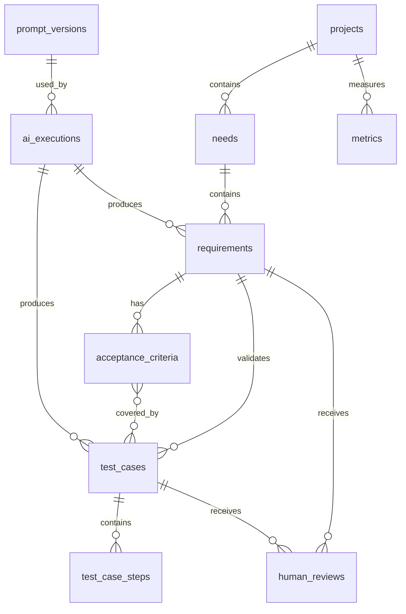

# Modelo de datos y diagrama entidad-relación

## Entidades



## Decisiones de diseño

- Cada tabla tiene una clave primaria `id` numérica.
- Las relaciones se protegen con claves foráneas y borrado en cascada donde el registro hijo no tiene sentido sin su padre.
- `acceptance_criteria` es una tabla, no un JSON dentro de `requirements`, y se relaciona explícitamente con `test_cases` mediante `test_case_criteria`.
- `test_case_steps` es una tabla ordenada por `(test_case_id, step_order)`.
- Cada requisito y caso de prueba conserva la ejecución IA que lo produjo.
- `prompt_versions` permite reproducir qué plantilla se utilizó.
- `human_reviews` conserva el valor original, el nuevo valor, la acción y el motivo.
- La restricción `ck_review_single_target` obliga a que una revisión pertenezca a un requisito o a un caso de prueba, pero no a ambos.
- Los códigos son únicos dentro de su padre: un `REQ-001` puede existir en otro proyecto o necesidad, pero no repetirse dentro de la misma necesidad.

## Tablas

| Tabla | Propósito | Relaciones principales |
|---|---|---|
| `projects` | Agrupa el trabajo | raíz del modelo |
| `needs` | Necesidades de negocio | pertenece a `projects` |
| `requirements` | Requisitos estructurados | pertenece a `needs` y opcionalmente a `ai_executions` |
| `acceptance_criteria` | Criterios verificables | pertenece a `requirements` |
| `test_cases` | Casos de prueba | pertenece a `requirements` y opcionalmente a `ai_executions` |
| `test_case_criteria` | Cobertura verificable | enlaza criterios de aceptación con casos de prueba |
| `test_case_steps` | Pasos ordenados | pertenece a `test_cases` |
| `prompt_versions` | Plantillas versionadas | es utilizada por `ai_executions` |
| `ai_executions` | Auditoría de llamadas IA | referencia a `prompt_versions` |
| `human_reviews` | Auditoría humana | referencia a requisito o caso |
| `metrics` | Valores calculados por proyecto | pertenece a `projects` |

## Estados

Los requisitos siguen este flujo:

```text
GENERATED → IN_REVIEW → APPROVED
                    └──→ REJECTED
```

Solo `APPROVED` permite ejecutar el Agente de Pruebas.

## Indicadores calculados

La API calcula por proyecto:

- tiempo promedio de generación en milisegundos;
- porcentaje de requisitos completos;
- porcentaje de requisitos aprobados con pruebas;
- porcentaje de criterios de aceptación cubiertos por pruebas.

Las metas iniciales son reducción de tiempo de al menos 25 % frente a la línea base manual, completitud de al menos 90 % y trazabilidad y cobertura de al menos 95 %.
